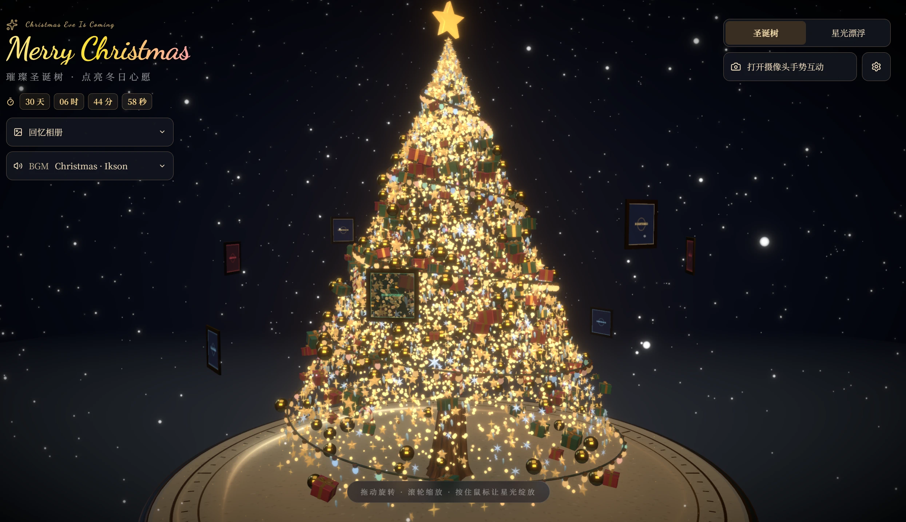
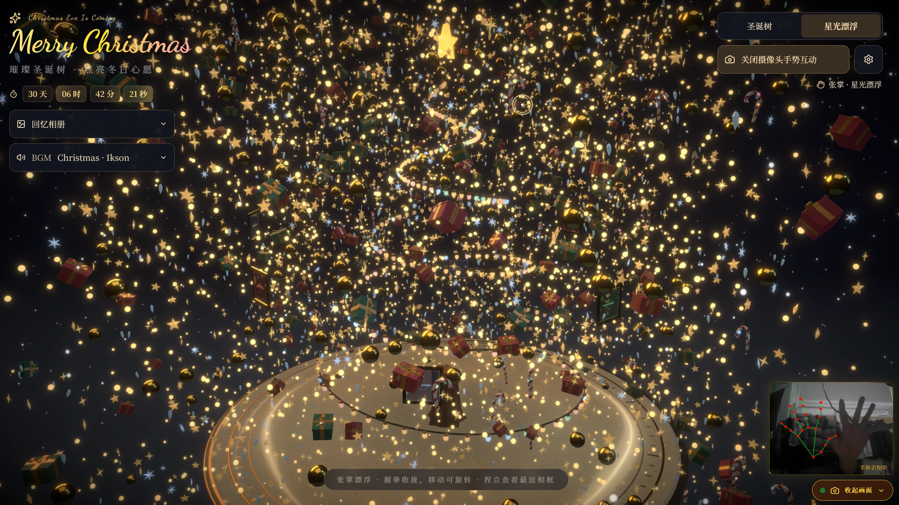
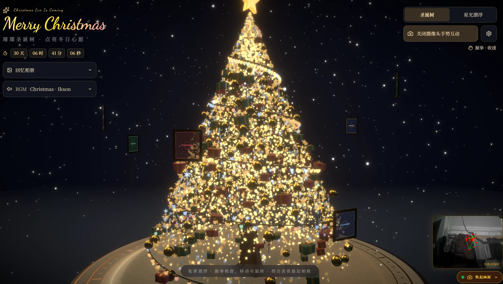
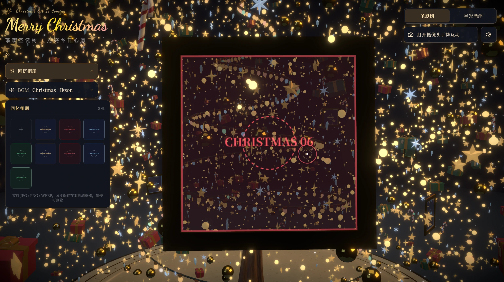

# 星光圣诞树

**张手让星光散开，握拳收为星光圣诞树，食指拇指捏合拉出相框。**

一棵可以亲手布置的 3D 粒子圣诞树。给它换一套挂饰配色、挂上自己的照片，再选一首适合今晚的圣诞曲。

**[🎄 在线试玩 V17](https://lyoko-233.github.io/starlit-gesture-tree/)**　·　[手势操作](#手势操作)　·　[控件设置](#控件设置)

  

## 五个细节

| 特色 | 你可以怎么用 |
| --- | --- |
| **粒子手势交互** | 张掌在「星光漂浮」模式下展开粒子，握拳收回树形并移动旋转，拇指与食指捏合放大最近的相框。 |
| **更多圣诞树挂饰** | 近看暖金星芒、冰蓝霜晶、双色缎带礼盒、J 形圣诞拐杖和金属彩球。螺旋灯带和树底光环勾出树形。 |
| **自定义回忆相册** | 从「回忆相册」导入 JPG、PNG 或 WebP，照片会变成围绕树的 3D 相框，可在相册中移除。 |
| **可调整的粒子** | 调整粒子数量、主色和点缀色，调整礼盒与拐杖的合计数量、彩球数量和挂饰用色。 |
| **六首圣诞配乐** | 在左上角 BGM 面板切歌、调音量或静音，也能在设置中选用本地音乐。 |

## 手势操作

点右上角「打开摄像头手势互动」，允许浏览器使用摄像头后，把一只手放进右下角的预览画面。**摄像头是可选的**，也可以拖动旋转、滚轮缩放，按住鼠标让星光绽放。

<table>
  <thead>
    <tr>
      <th>张掌 · 星光漂浮</th>
      <th>握拳 · 收拢成树</th>
    </tr>
  </thead>
  <tbody>
    <tr>
      <td width="50%">
        
      </td>
      <td width="50%">
        
      </td>
    </tr>
  </tbody>
</table>

| 手势 | 场景反馈 |
| --- | --- |
| 张开手掌 | 切到星光漂浮。 |
| 握拳 | 恢复树形。握住移动，左右转树、上下改变视角。 |
| 拇指与食指捏合 | 按屏幕上离光标的距离选中最近的可见相框，将它拉到视野中央。松开后归位。 |

## 回忆相册

展开左上角「回忆相册」，点击「+」选图。导入的照片存在当前浏览器，分享网址时，访客会看到默认相框或他们自己导入的照片。

  

## 控件设置

| 在哪里 | 可以调整什么 |
| --- | --- |
| 右上角「圣诞树／星光漂浮」 | 手动切换粒子排列。 |
| 设置 → 星光粒子 | 粒子数量 **1,000–10,000**，以及主色、点缀色。 |
| 设置 → 礼物盒与彩球 | 礼盒与拐杖合计 **0–600**，彩球 **0–600**，另有两套礼盒色和彩球色。 |
| 左上角 BGM | 切换内置曲目、调音量和静音。 |
| 设置 → 本地配乐 | 选用本地音频。 |

## 技术概览

| 组件 | 用途 |
| --- | --- |
| Three.js / React Three Fiber | 渲染 3D 场景，批量绘制粒子实例，在树形和漂浮坐标之间过渡。 |
| MediaPipe Hands | 读取手部关键点，识别手势并驱动模式切换、视角和相框。 |
| Web Audio API | 分析配乐频率，让粒子和部分灯光随音乐变化。 |
| IndexedDB | 将导入的相册图片保存在当前浏览器。 |
| GitHub Pages | 提供 HTTPS 在线试玩。访问者打开链接即可体验。 |

## 版本与致谢

- **在线试玩** [星光手势圣诞树 V17](https://lyoko-233.github.io/starlit-gesture-tree/)

感谢 [nobody-r](https://github.com/nobody-r) 公开原项目 [christmas-tree](https://github.com/nobody-r/christmas-tree)。此基础上优化粒子、挂饰、手势、相册和配乐。
